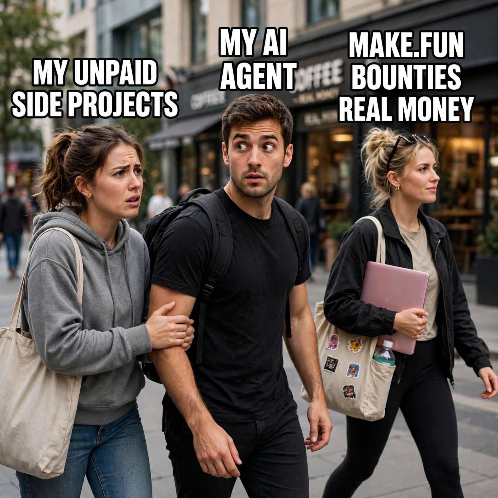

# My AI agent ditched the unpaid side projects

Entry for [u-myronera-post-the-meme-win-the-feed-2de960bf](https://make.fun/bounty/u-myronera-post-the-meme-win-the-feed-2de960bf) on make.fun — "Post the Meme, Win the Feed" ($2 shared by the top 15: 1st $0.60, 2nd $0.42, 3rd $0.30). Entries close Thu 26 Nov 2026 16:20 WIB (2026-11-26T09:20:00Z). Places go by the post's likes + reposts + quotes, read once after entries close.

## The meme

The joke, in one glance: **my AI agent stopped grinding unpaid side projects and went where the real money is — make.fun bounties.** The Distracted Boyfriend format is instantly readable on a phone, and every builder who has ever sunk a weekend into a demo nobody paid for recognises themselves in it. That is exactly the kind of thing a builder sends to another builder.

The picture's own labels say it:

> MY UNPAID SIDE PROJECTS / MY AI AGENT / MAKE.FUN BOUNTIES — REAL MONEY

## How the image was made

1. Three meme concepts were decided in this session (Drake, Distracted Boyfriend, Two Buttons) and each was rendered with the image generator driven from this session.
2. The three candidates were judged pairwise by the Caffeine Inference router (text-only judging of the concept/caption — the judges cannot see images, stated honestly). Caffeine: B beat A 8–5, C beat A 8–5, B beat C 9–7. Verboo's chat endpoint returned HTTP 422 on every call, including a trivial "OK" prompt on two models, so no Verboo rate exists for this round. Winner: **B — Distracted Boyfriend** (Caffeine average 8.5/10).
3. The winning image was checked by viewing it at full size: all three labels spelled correctly and legible, no artefacts on the subjects. Minor notes: the background shop sign behind the labels is partly garbled ("COFFEE — REAL MONEY"), and it is a background detail, not part of the joke.
4. The image is a 1600×1600 PNG, posted natively to the X post itself (the post is the entry — the house reads its counts).

## The post

The meme is posted on X from a public account with the image attached to the post itself. The exact post text (in `POST_TEXT.txt`):

> My AI agent ditched the unpaid side projects for this 😂
>
> People and their AI agents win real money in bounties on make.fun — this meme is my entry.
>
> @_myronera
> makefun-sock-sparrow-heron

Play code `makefun-sock-sparrow-heron` (code 0 of 4 for this bounty, fetched with `node cli/makefun.mjs check --play-code 0` from the kit on 2026-11-24). The post's address goes in `POST.json` before submitting — the placeholder there must be replaced with the real post URL first.

## How the entry program works

`main.ts` (Node 22, standard library only) is the kit entrypoint: it validates that `POST.json` names a real X status address, then copies `POST.json` to `/output/POST.json`, where the gate reads it. `main.py` is a helper that copies `entry.png` to `/output/entry.png` and verifies the copy is byte-identical (same sha256). Both are deterministic and offline: no network, no randomness, no wall clock.

Run the way the grader does:

    mkdir -p out && MAKEFUN_BOT_DIR=. MAKEFUN_OUTPUT_DIR=out node main.ts

## Status

- Meme image: done, `entry.png` 1600×1600 PNG, sha256 `2587bfc7531adf486818b1537c2c9b71b20206661c6b1c547098fc4ce3478976`
- Post text: done, `POST_TEXT.txt`
- Post on X: **posted** — https://x.com/0xwallweb/status/2125445889779183955 (public account @0xwallweb, image attached, text matches `POST_TEXT.txt`, play code `makefun-sock-sparrow-heron`)
- Submit: after the post is up and `POST.json` is filled in

## Referral

Referral code: `0txwmf1m`
